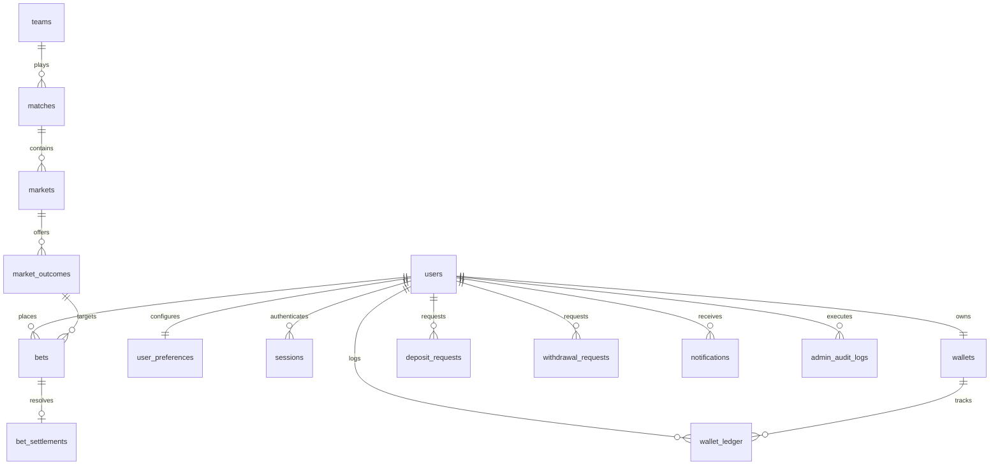

# IRONMAN TOSS BOOK - Relational Database Architecture Plan

## 1. Overview & Core Philosophy

The database architecture for **IRONMAN TOSS BOOK** is built on **MySQL (v8.x+)** to guarantee strict ACID compliance, transactional integrity, and mathematical precision for financial ledger accounting.

> [!NOTE]
> Day 1 establishes the schema architecture and planning documentation. The actual physical DDL execution and seed scripts will be implemented on **Day 9 (MySQL Schema and Seed Data)**.

---

## 2. Core Database Principles

1. **Strict Foreign-Key Integrity**: Relational constraints (`FOREIGN KEY ... REFERENCES ... ON DELETE RESTRICT`) ensure orphaned records or dangling balances are mathematically impossible.
2. **DECIMAL Monetary Precision**: All balances, stakes, odds rates, and financial transactions use `DECIMAL(12, 2)` (or `DECIMAL(6, 2)` for odds) to prevent binary floating-point roundoff errors.
3. **Double-Entry & Immutable Ledger**: Wallets reflect a live calculated balance, but every change is backed by an append-only, immutable `wallet_ledger` record with a unique transaction reference UUID.
4. **Atomic Transactions**: All wagering operations and balance adjustments execute inside explicit MySQL transactions (`START TRANSACTION ... COMMIT / ROLLBACK`) with row-level locking (`SELECT ... FOR UPDATE`).
5. **Parameterized Prepared Statements**: 100% of queries use placeholder parameterization (`?`) via `mysql2` to prevent SQL injection.
6. **Optimized Indexing**: Foreign keys, status filters, user IDs, and timestamps are explicitly indexed to guarantee sub-millisecond query performance.
7. **Administrative Auditability**: Every administrative action (market creation, settlement, balance intervention) writes an immutable record to `admin_audit_logs`.

---

## 3. Entity Catalog & Table Specifications

### A. Authentication, Users & Preferences

#### 1. `users`
- **Purpose**: Core user account entity containing authentication credentials and account status.
- **Key Fields**: `id`, `username`, `phone`, `email`, `password_hash`, `role` (`user`, `admin`, `super_admin`), `status` (`active`, `suspended`, `banned`), `created_at`, `updated_at`.
- **Relationships**: One-to-one with `wallets` and `user_preferences`; one-to-many with `bets`, `wallet_ledger`, and `deposit_requests`.

#### 2. `user_preferences`
- **Purpose**: Stores personalized UI settings and notification preferences.
- **Key Fields**: `user_id`, `dark_mode_enabled` (boolean), `push_notifications` (boolean), `sms_alerts` (boolean), `updated_at`.
- **Relationships**: Foreign key to `users.id` with `ON DELETE CASCADE`.

#### 3. `sessions`
- **Purpose**: Server-managed stateful sessions or refresh tokens with cryptographic entropy.
- **Key Fields**: `id` (session token hash), `user_id`, `ip_address`, `user_agent`, `expires_at`, `created_at`.
- **Relationships**: Foreign key to `users.id` with `ON DELETE CASCADE`.

---

### B. Sports, Matches & Toss Markets

#### 4. `teams`
- **Purpose**: Competing sports teams or franchises (e.g., India, Australia, Mumbai Indians).
- **Key Fields**: `id`, `name`, `short_code` (e.g., `IND`, `AUS`), `logo_url`, `created_at`.
- **Relationships**: Referenced by `matches.team_a_id` and `matches.team_b_id`.

#### 5. `matches`
- **Purpose**: Specific sports events / fixtures where toss betting occurs.
- **Key Fields**: `id`, `tournament_name`, `team_a_id`, `team_b_id`, `match_time`, `toss_status` (`upcoming`, `open`, `locked`, `completed`, `cancelled`), `toss_winner_team_id`, `created_at`.
- **Relationships**: Foreign keys to `teams` and one-to-many with `markets`.

#### 6. `markets`
- **Purpose**: Wagering market types for a match (primarily "Match Toss Winner").
- **Key Fields**: `id`, `match_id`, `market_name` (e.g., "Toss Winner"), `status` (`open`, `suspended`, `settled`), `closing_time`.
- **Relationships**: Foreign key to `matches.id`.

#### 7. `market_outcomes`
- **Purpose**: The selectable sides in a market (e.g., Team A Toss Winner vs Team B Toss Winner) with current rates.
- **Key Fields**: `id`, `market_id`, `team_id`, `outcome_name`, `rate` (`DECIMAL(6,2)`), `status` (`active`, `won`, `lost`, `void`).
- **Relationships**: Foreign keys to `markets.id` and `teams.id`.

---

### C. Bets & Settlements

#### 8. `bets`
- **Purpose**: Individual wagers placed by users on a specific toss outcome.
- **Key Fields**: `id`, `user_id`, `match_id`, `market_outcome_id`, `stake_amount` (`DECIMAL(12,2)`), `rate` (`DECIMAL(6,2)`), `potential_payout` (`DECIMAL(12,2)`), `status` (`placed`, `won`, `lost`, `cancelled`, `refunded`), `created_at`.
- **Relationships**: Foreign keys to `users.id`, `matches.id`, `market_outcomes.id`.

#### 9. `bet_settlements`
- **Purpose**: Formal ledger record of bet evaluation and payout settlement.
- **Key Fields**: `id`, `bet_id`, `settled_by_admin_id`, `outcome_result` (`won`, `lost`, `void`), `settled_amount` (`DECIMAL(12,2)`), `settled_at`, `notes`.
- **Relationships**: Foreign keys to `bets.id` and `users.id` (admin).

---

### D. Wallet & Financial Ledger

#### 10. `wallets`
- **Purpose**: Real-time snapshot of user financial balances.
- **Key Fields**: `id`, `user_id`, `available_balance` (`DECIMAL(12,2)`), `exposure_balance` (`DECIMAL(12,2)`), `currency` (default `INR`), `version` (optimistic locking counter), `updated_at`.
- **Relationships**: Foreign key to `users.id` with `UNIQUE` constraint.

#### 11. `wallet_ledger`
- **Purpose**: Immutable, double-entry financial transaction log (the backbone of the Passbook view).
- **Key Fields**: `id`, `transaction_ref` (UUID / alphanumeric reference), `wallet_id`, `user_id`, `type` (`credit`, `debit`), `category` (`deposit`, `withdrawal`, `bet_stake`, `bet_winnings`, `bet_refund`, `adjustment`), `amount` (`DECIMAL(12,2)`), `balance_before` (`DECIMAL(12,2)`), `balance_after` (`DECIMAL(12,2)`), `description`, `created_at`.
- **Relationships**: Foreign keys to `wallets.id` and `users.id`.

#### 12. `deposit_requests`
- **Purpose**: User-initiated deposit requests pending payment verification.
- **Key Fields**: `id`, `user_id`, `amount` (`DECIMAL(12,2)`), `payment_method` (`UPI`, `Bank Transfer`, etc.), `utr_number`, `proof_image_url`, `status` (`pending`, `approved`, `rejected`), `reviewed_by_admin_id`, `admin_notes`, `created_at`, `reviewed_at`.
- **Relationships**: Foreign keys to `users.id` and reviewer admin.

#### 13. `withdrawal_requests`
- **Purpose**: User-initiated payout requests subject to balance verification and administrative approval.
- **Key Fields**: `id`, `user_id`, `amount` (`DECIMAL(12,2)`), `bank_details_snapshot` (JSON or dedicated columns), `status` (`pending`, `processing`, `completed`, `rejected`), `reviewed_by_admin_id`, `rejection_reason`, `created_at`, `processed_at`.
- **Relationships**: Foreign keys to `users.id` and reviewer admin.

---

### E. System Governance, Notifications & Auditing

#### 14. `notifications`
- **Purpose**: Real-time and historical push/in-app alert items for users.
- **Key Fields**: `id`, `user_id`, `title`, `message`, `type` (`bet_outcome`, `deposit_status`, `system_notice`), `is_read` (boolean), `created_at`.
- **Relationships**: Foreign key to `users.id`.

#### 15. `announcements`
- **Purpose**: Live platform marquee ticker messages and modal popups.
- **Key Fields**: `id`, `title`, `message`, `is_active` (boolean), `priority_order`, `starts_at`, `ends_at`, `created_at`.

#### 16. `app_rules`
- **Purpose**: Governance, platform rules, terms and conditions, toss rules, and settlement criteria displayed in Profile > App Rules.
- **Key Fields**: `id`, `rule_category` (e.g., "General", "Toss Rules", "Withdrawal Rules"), `rule_title`, `rule_content`, `display_order`, `updated_at`.

#### 17. `admin_audit_logs`
- **Purpose**: Tamper-evident record of all administrative interventions.
- **Key Fields**: `id`, `admin_id`, `action_type` (`match_create`, `result_declare`, `deposit_approve`, `withdrawal_reject`, `manual_balance_adjust`), `target_entity_type`, `target_entity_id`, `ip_address`, `details` (JSON before/after payload), `created_at`.
- **Relationships**: Foreign key to `users.id` (admin).

---

## 4. Entity-Relationship Overview Diagram

---

## 5. Implementation Roadmap Milestones
- **Day 1**: Database Plan & Architectural Documentation (Complete).
- **Day 9**: DDL Schema script (`backend/database/schema.sql`), Indexes, Foreign Keys, and Realistic Seed Data (`seed.sql`).
- **Day 10**: Connection pooling, health verification route, and query helpers.
